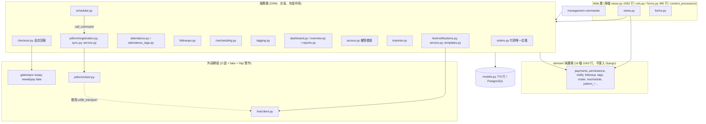

# teacher-crm 現況架構評估

- 評估日期：2026-11-13　角色：architect（接手／評估模式，唯讀）
- 對象：`/Users/Park/Site/teacher-crm`，branch `master`，Django 5.2 / PostgreSQL 16 / 純 template
- 依據：`docs/code_map/`（INDEX、modules、routes、models）、`specs/constitution.md` v1.0.0、`specs/SITEMAP.md`、`specs/001~004`，並對關鍵程式用行號區段讀取。
- 沒有通讀全部程式。測試只做抽樣與搜尋，沒有執行任何測試。

## 0. 本次評估的限制與可信度

| 項目 | 說明 |
|---|---|
| 無法執行指令 | 本次環境沒有 Bash，只能用 Read／Grep。**沒有**執行 `git status`／`git diff`、`make codemap-check`、`make test`、`make lint`。因此無法確認哪些 hunk 屬於未提交變更，也無法確認程式碼地圖是否 STALE（地圖含 `config.origins`，推測已含未追蹤檔，但未驗證）。 |
| 涉及未提交變更的結論 | 標 **[WIP]** 者，所在檔案屬 profile 列出的未提交清單（`settings.py`、`jotform/client.py`、`jotform/registration.py`、`pay.html`、`compose.yaml`、`.env.example`、`origins.py`）。檔案層級標記，hunk 層級未區分；請以使用者提交後的狀態為準重驗。 |
| 並行與效能結論 | 來自讀程式的推論，沒有壓測或重現。標「推論」。 |
| 禁區 | 沒有讀 `.env`、`.pytest_cache`、`manifest.json`。 |

## 1. 現況架構還原

### 1.1 系統定位

銷講課程（前端課）行政系統：多專案（租戶）隔離，四種角色（admin／行政管理者／行政專員／講師），涵蓋 場次、學員、報名、訂單與付款（金流 ECPay／NewebPay、轉帳人工對帳、現場收款）、標籤、改期、點名、追售、LINE 通知與綁定、每週與前一天回報、Jotform 報名表同步與報名導向。

單一 Django app（`crm`）＋ `config`；約 23k 行 Python（含測試），src 約 4.5k（crm 根）+ 子套件；31 個 migration；71 條路由；36 個 template。

### 1.2 分層與模組圖（實際依賴方向）

重點觀察：

1. 三層分工（domain 純邏輯 / 服務層 / view）整體清楚，且有 code map 與測試守住。外部服務（金流、LINE、Jotform）都有「介面 + fake + 真實實作 + 可注入傳輸層」，符合 MUST 7。
2. 唯一的跨層怪異耦合：`jotform/client.py:137` 為了 `urllib_transport` 匯入 `crm.line.client`，Jotform 依賴 LINE 模組。傳輸層應抽成共用模組（如 `crm/http.py`）。
3. 排程：`run_scheduler`（長駐迴圈 + PostgreSQL advisory lock `scheduler.py:16,59`）設計正確，可多開不重複。**但登錄表只有 2 個 Jotform job**（`scheduler.py:74-85`），見 §3 F-1。
4. 資料隔離：`ProjectScopedQuerySet.for_project/visible_to`（`models.py:84-89`）＋ view 入口 `_project_or_404`（`views.py:258-259`，以 `Project.objects.visible_to(user)` 取專案）。隔離靠「view 慣例」，不是框架層強制。

### 1.3 資料模型概況

專案（`Project`）為租戶根；`Student`、`Session`、`Registration`、`Product`、`Order`、`Payment`、`PaymentAttempt`、`TransferClaim`、`StudentTag`、`TagEvent`、`Attendance`、`FollowUp`、`Reschedule`、`LineConfig/LineAccount/BindingIssue/MessageTemplate/OutboundMessage`、`GatewayConfig`、`JotformForm/JotformSessionOption/JotformSubmission`、`JobRun` 皆帶 `project` 外鍵。

良好之處：金額一律 `PositiveIntegerField`（無 float／Decimal，grep `src/` 無 `float(`／`DecimalField`）；訂單有部分唯一約束 `unique_active_order_per_student_product`（`models.py:215-221`）、每專案唯一前端課（`:168-174`）、`Student(project,name,phone)` 唯一、`OutboundMessage` 唯一（`:518-523`）、`JotformSubmission.submission_id` 全域唯一；機敏欄位 Fernet 加密（`crypto.py`）。

## 2. 憲法 10 條 MUST + 流程關卡 逐條對照

圖例：符合／部分／違反／未保護（目前靠慣例，沒有機制或測試守住）。

| # | 條文 | 判定 | 證據與說明 |
|---|---|---|---|
| 1 | 測試先行 | 未驗證 | `specs/TDD_PROGRESS.md` 已停更（歷史）；001~004 的 `tasks.md` 全數勾選（511 項，無未勾）。TDD 順序無法從成品驗證。CI 覆蓋率門檻 95%（`ci.yml:66`）。 |
| 2 | 真實 DB、禁 mock | 符合 | 搜尋 `tests/` 無 `unittest.mock／MagicMock／mocker`；`monkeypatch.setattr` 只用於替換外部 client 建構與 `_sleep`、getpass（`tests/db/conftest.py:11,26`）。 |
| 3 | domain 不匯入 Django | 符合 | `src/crm/domain/` 內只有 `jotform_options.py:5 import urllib.parse`（標準庫）。無 `django`／`crm.models` 匯入。 |
| 4 | 專案完全隔離 | 部分／未保護 | 見 F-6。view 路徑普遍用 `for_project`；測試有 86 處跨專案斷言（29 檔）。但**無框架層強制**：任何新 view 忘記 `for_project` 就洩漏；`Registration/Order/Payment` 的 `project` 與 `student.project/session.project` 一致性無 DB 約束（只有 `create_order:72` 與 `reschedule_student:16`、`attendance._check_project` 在服務層檢查）。`views.py:444-446,1036` 以 student 為界查 tag（上游 student 已限定專案，目前安全）。 |
| 5 | 權限伺服器端 | 部分 | 角色表在 domain（`permissions.py:60-74`）且有測試。但每個 view 要自己呼叫 `_require(...)`；`project_sessions/session_detail/students/products/front_course/payments/reschedule/attendance/follow_ups` 只靠 `_project_or_404`（講師可讀，符合 SITEMAP 決策 `SITEMAP.md:123`），寫入類都有 `_require`。目前未見遺漏，但屬「靠 code review」。`project_payments`（`views.py:677-720`）對講師可見金額與付款狀態，與規格 001 後的決策是否一致需 PM 確認（見 §4）。 |
| 6 | 系統為單一事實來源 | 部分 | 「已付款」定義集中在 `orders.paid_intro_student_ids`（`orders.py:49-55`）。但**刪除學員會連帶硬刪訂單與收款紀錄**（F-4），破壞單一事實來源的可稽核性。 |
| 7 | 外部先 fake | 符合 | `gateways/fake.py`、`FakeLineClient`、`FakeJotformClient`；`tests/integration/` 獨立（僅 ECPay stage）。 |
| 8 | 金額整數、機密加密不回顯不進日誌 | 部分 | 金額整數符合。加密有，但：`crypto.py:13` 金鑰缺省退回 `SECRET_KEY`，且 `settings.py:8` 的 `SECRET_KEY` 有不安全預設值、`DEBUG` 預設為 1（`settings.py:9`）；無金鑰輪替機制（單 Fernet）；SECRET_KEY 一換，所有金流與 LINE 憑證即無法解密。LINE webhook 通知網址含密鑰（`jotform_webhook` URL token）顯示於設定頁（有權限控管，`views.py:530-542`）。 |
| 9 | 外部通知可重送 | 部分 | 金流：驗簽 + `PaymentAttempt` 狀態機 + `select_for_update`，重送回 `DUPLICATE`（`checkout.py:70-110`），**符合**。LINE webhook：驗簽有（`views.py:1166`），綁定流程大致冪等；沒有以 `webhookEventId` 去重，重送會重複 `reply_text`（不改狀態，風險低）。Jotform webhook 以提交編號鎖列去重（`registration.py:89-100`），符合。 |
| 10 | 發送前再檢查 | **違反（部分）** | 見 F-3。`_deliver`（`notifications.py:158-180`）只檢查綁定與封鎖，**不重新確認發送條件**（已付款、已報進階、追售是否已停止）。`retry_message`（`:232-240`）直接重送建立當時渲染好的文字（含付款連結），學員已付款或已報名後仍會被發。`SITEMAP.md:68`「發送前自動檢查是否已報名 → 已報名即停止」在重送路徑未落實。 |
| 流程 | 交易內不得同步呼叫外部服務 | 符合（有緊繃之處） | 所有 `atomic` 區塊（`orders/checkout/attendance/registration/...`）內未見外部呼叫；`sync.py` 明文「外部呼叫在交易外」。但外部呼叫大量發生在 **request 內**（見 F-7）。 |
| 流程 | 有限資源以 DB 鎖保護 | **部分／語意不一致** | 見 F-2。只有 `rescheduling.py:21` 鎖 `Session`；其他報名建立路徑（Jotform `_book`、CSV 匯入、現場報名、提前報到、人工 resolve）**都不鎖也不檢查人數上限**。 |
| 流程 | 全走 ORM／raw SQL 需註解 | 符合（小瑕疵） | 僅 `scheduler.py:27-28,59,71` 的 `pg_try_advisory_lock`，docstring 有說明（`:3-4`），但憲法要求的是「程式註解說明 raw SQL 原因」，`_lock` 本身沒有逐處註解，建議補一行。 |
| 流程 | migration 與 `makemigrations --check` | 符合 | CI 有跑（`ci.yml:65`）。 |
| 流程 | 使用者可見用語統一 | 部分 | `models.py:34-36` 保留舊函式只為舊 migration；`retagging.py` 有舊稱改名；有 `tests/unit/test_wording`。未見風險。 |

## 3. 主要發現（依嚴重度）

### F-1　（高）核心 SOP 自動化沒有被排程：每日 LINE 通知、結束場次、追售都靠「外部 cron」，但專案內沒有任何登錄或文件

- 證據：`scheduler.py:74-85` 只登錄 `sync_jotform_forms`、`process_jotform_submissions`；`compose.yaml:39-48` 的 `scheduler` 只跑 `run_scheduler`；搜尋 `src/`、Makefile、compose、README／docs 沒有 `send_line_notifications`、`process_finished_sessions` 的排程設定或 cron 說明（只有 `specs/TEST_LIST.md:710` 寫「正式環境用 cron 或排程器」）。003 的 `technical-research.md:77` 也預告「日後只要加進登錄表即可」，但至今未做。
- 影響：課前 3／2／1 天通知、場次結束與 7 天追售（SITEMAP M3/M4 的價值核心）是否真的每天跑，取決於部署端是否另設 cron；專案內無法驗證，也不是「可重跑」被保護的設計（見下）。**待釐清**：實際部署是否有主機 cron？（本次無法確認，需使用者回答。）
- 加重因素：通知以「今天 ± 精確天數」判斷（`domain/notify.py due_kinds`、`followup.follow_up_stage`：只有第 1、3、7 天）。若某天沒跑，該階段通知與追售訊息**永遠補不回來**（沒有 catch-up）。憲法要求排程「可安全重跑」——重跑安全（有唯一約束與狀態檢查），但「漏跑可補」未保證。
- 建議：把兩個 command 登錄進 `registered_jobs()`（每日定時，利用 `JobRun` 記錄），加 catch-up（以「應發而未發」計算而非精確日數）。價值高、成本 S～M。

### F-2　（高）場次人數上限：憲法要求 DB 鎖，現況只有一條路徑有鎖，且「額滿」有兩套定義

- 證據：
  - 鎖：僅 `rescheduling.py:20-30`（以 **報名人數** 對 `capacity` 做硬檢查）。
  - 無鎖也無上限檢查：`importer.py:25-36`（CSV）、`jotform/registration.py:84-122 _book`、`attendance.py:116-152 register_walk_in`、`attendance.py:80-113 check_in_early`（註明「不受人數上限限制」是設計）、`registration.py:129-157 resolve`。
  - 軟上限：Jotform 表單選項用 **已付款人數 ≥ capacity** 才下架（`domain/jotform_options.py:110`、`jotform/sync.py:32-42`），而且是每 60 秒才同步一次；儀表板把「已付款 > 上限」列為異常（`domain/dashboard.py:108-110`）；`views.py:1076` 與 `overview.py:48` 又用不同口徑顯示剩餘名額（報名數 vs 付款數）。
- 影響：(a) 名額最後幾位同時報名或同時付款，可超收，且系統不會阻擋，只事後告警；(b) 同一個「額滿」在改期（報名數）與表單／通知（付款數）判斷不同，T-2 分流（`t2_kind`，付款數）與改期結果可能互相矛盾；(c) 違反憲法「有限資源 MUST 以 DB 鎖保護」的字面。
- 這也可能是商業上刻意的「先報名後付款」模型：SITEMAP 決策（`SITEMAP.md:198`）確實定義額滿 = 已付款 ≥ 上限。所以真正的缺口是：**付款入帳（`record_payment`）這個消耗名額的動作沒有對 `Session` 加鎖也沒有檢查**，與憲法字面不符。
- **需使用者／PM 拍板**：名額到底卡在「報名」還是「付款」？是否允許超收（目前等同允許並告警）？釐清後才能決定改法（於付款入帳鎖 `Session` 並提示，或維持軟上限並把憲法註記例外）。
- 影響 [WIP]：`registration.py` 屬未提交檔，但該路徑在 004 前即無鎖。

### F-3　（高）MUST 10 在重送與待發訊息路徑未落實

- 證據：`notifications.py:158-180 _deliver`、`:232-240 retry_message`、`:243-282 send_payment_reminders`、`:106-120 _send`（只在建立當下依 `_plan` 判斷，`OutboundMessage` 若狀態仍 `PENDING`——例如程序中途終止——下一輪直接 `_deliver`，沿用舊文字，`:118-120`）。
- 影響：失敗訊息由行政人員重送時，學員可能已付款或已報進階，仍收到「付款提醒（含付款連結）」或追售訊息；追售訊息在 `_run_follow_ups`（`:92-103`）迴圈中使用迴圈開始時載入的 `FollowUp` 物件，迴圈期間被人工停止也不會中止。
- 建議：把「發送前條件」抽成 domain 純函式（依 kind 回傳是否仍應發），`_deliver` 前呼叫；不符即標 `SKIPPED` 並寫原因。成本 M，價值高（直接觸及客戶體驗與信任）。

### F-4　（高）刪除學員會硬刪訂單與收款紀錄

- 證據：`views.py:467-481` 學員刪除只有確認頁，警語寫「報名會一併刪除」；`models.py:200 Order.student on_delete=CASCADE`、`:237 Payment.order CASCADE`、`PaymentAttempt/TransferClaim.order CASCADE`。刪除已付款學員 ⇒ 該筆訂單與全部 `Payment`／`PaymentAttempt` 一併消失，而金流端與銀行帳上仍有紀錄。
- 影響：財務稽核與金流對帳無法還原；與「系統為單一事實來源」衝突；也無法回答「這位學員何時付過款」。（`DELETE_DATA` 僅行政管理者以上可做，風險被權限降低，不是消除。）
- 建議：有任何收款（或有 PaymentAttempt）時禁止刪除，或改為軟刪除／匿名化；`Order.student` 改 `PROTECT`。成本 S～M；需要 PM 決定業務規則（見 §6）。
- 另：`ensure_intro_orders`（`orders.py:98-107`）與 `Student.delete` 沒有稽核事件，刪除人是誰也沒記錄（無 audit log，見 F-8）。

### F-5　（中高）Jotform 報名導向／提交處理：公開端點的濫用面與流程負載 [WIP]

檔案：`jotform/registration.py`（未提交）、`views.py:1492-1507`、`views.py:1581-1592`。

- `jotform_return` 免登入、`csrf_exempt`，任何人帶任意提交編號即觸發向 Jotform 的同步 API 呼叫，最多 `REDIRECT_ATTEMPTS=3` 次並 `time.sleep(1)`（`registration.py:173-178,238-250`），佔用 web worker 且消耗 Jotform 額度（429 被視為暫時錯誤，反過來影響真正的報名）；無速率限制。
- 以時效 30 分鐘（`settings.py:22`）防止重放，但窗內若有他人猜到相鄰提交編號（Jotform 提交編號為連號大整數、同一帳號下單調遞增），且該提交屬於同一表單，會被導向「別人訂單的付款頁」（付款頁姓名遮罩 `mask_name`，風險有限，但可看到金額與狀態、可替他人發起付款）。建議資安審查列為待驗項。
- `OTHER_SESSION` 規則（`registration.py:277-283`）：只要學員在專案內有任一**其他**場次報名（含已結束場次）就轉人工。實務上「已報名但改期」或「舊場次沒到、重新報名」都會落入人工清單；而 `Registration` 在場次結束後不會清除。這是規格 004 US2-4 的決策，但會持續製造人工負擔。→ 建議蒐集一段時間的 `JotformSubmission.reason` 分佈再決定是否放寬（只比對**未結束**場次）。
- `JOTFORM_TIMEZONE` 預設值：程式 `settings.py:21`（`America/New_York`）與 004 規格／`integration-plan.md:11`／`tasks.md:47`（`Asia/Taipei`）不一致；`SITEMAP.md:268-269` 也標明「待上線前實測」。這是有意的實測修正，但規格沒有同步更新（見 §5）。
- 好的一面：`_book` 以 `select_for_update` 鎖提交列去重（`:89-100`）、外部查詢在交易外、訂單編號 = 提交編號且有 `order_no` 唯一。

### F-6　（中）專案隔離靠「慣例」而非「機制」

- 現狀：`for_project()` 是 opt-in；`Student.objects.filter(...)`、`Order.objects.filter(...)` 一樣能寫出；`views.py` 約 50 處手動呼叫。測試覆蓋跨專案斷言多（86 處），但憲法要求「新增功能必附隔離測試」是流程守門，不是技術守門。
- 風險點（推論）：(a) 公開端點 `pay_page`、`gateway_notify`、`line_webhook`、`jotform_webhook` 以 `project_id` 或簽章 token 進入，之後的查詢是否都限定該專案，需要每次人工檢查；(b) `LineAccount.objects.filter(student=...)`（`notifications.py:159`、`service.py:100,113`）以 student 為界，沒有再加 `project`；(c) 沒有 DB 層一致性：`Registration.project` 可與 `student.project`／`session.project` 不同。
- 建議（低成本）：加一組「隔離一致性測試」：用反射掃描所有帶 `project` 的 model，檢查 `Registration/Order/Payment/Attendance/...` 的 `project == student.project == session.project`（可寫成 `tests/db` 的巡檢測試 + 定期資料健檢 command）。真正的 DB 層做法（複合外鍵）改動大，不建議。

### F-7　（中）慢的外部呼叫都在 web request 內同步執行

- 證據：`views.py:1456-1465`（一鍵發完款提醒：逐位學員 push，最多 3 次重試／人）；`views.py:1264-1279`（重送）；`views.py:1255`（通知頁面 render 時 `get_quota`）；`views.py:277,391,413`（場次異動後同步 Jotform，吞掉所有例外）；`views.py:574-593`（立即同步）；`views.py:1497-1502`（導向 + sleep）。
- 影響：Dockerfile 以 `runserver` 啟動（`Dockerfile:15`），單程序多執行緒；一個「發送 100 則」的請求就能長時間佔住。URL 超時由瀏覽器／反向代理決定。LINE 額度不足時 `state["quota_exhausted"]` 短路有做（`:165-166`），但仍是逐一寫庫。
- 不違反憲法（皆在交易外），但與「無佇列系統」的基線搭配時，應改成「request 只建立 `OutboundMessage(PENDING)`，由 scheduler 的 job 發送」——`OutboundMessage` 本來就是 outbox 形狀，改動風險低。成本 M。

### F-8　（中）可維運性空白：正式環境設定、日誌、稽核、速率限制

- `Dockerfile:15` 以開發伺服器啟動；`DEBUG` 預設 `1`、`SECRET_KEY` 預設 `dev-insecure-secret-key`、`FAKE_GATEWAY_ENABLED` 預設 `1`（`settings.py:8,9,13`）：忘了設環境變數就以不安全模式上線。`fake_checkout/fake_complete`（`views.py:973-1012`）在預設值下是公開路由（有簽章與 `provider == "fake"` 守門，風險受限）。
- 無 `LOGGING` 設定、無 `SECURE_*`／`SESSION_COOKIE_SECURE`／`CSRF_COOKIE_SECURE`／HSTS、無靜態檔處理（無 whitenoise／`STATIC_ROOT`）、`requirements.txt` 僅 Django、psycopg、cryptography；沒有 gunicorn。`Dockerfile` 安裝 `requirements-dev.txt`（含測試工具）到執行映像。
- 無登入失敗限制（沒有 axes／rate limit），公開 `pay_page` POST 可無限建立 `TransferClaim`（`views.py:917-919`，需有效 30 天簽章 token，但單一 token 無次數限制）。
- 稽核：有 `TagEvent`、`Reschedule`、`Attendance.marked_by`，但**金流與財務操作（確認入帳、退款、取消、刪學員、改價格、改設定）沒有操作者稽核紀錄**；`Payment` 無 `created_by`。
- 正向：排程 `JobRun`、設定頁顯示最後執行（`views.py:514`）；`scheduler` 失敗有 `logger.exception`；CI 有 lint + test + code map check + migration check，並含針對 workflow 的單元測試。
- 建議：「正式環境啟動前檢查」（`DEBUG=0`、非預設 SECRET_KEY、`FIELD_ENCRYPTION_KEY` 必填、`FAKE_GATEWAY_ENABLED=0`）寫成 `check` 部署檢查，缺則拒絕啟動；加 gunicorn 的 production 目標；`Payment.created_by` + 簡單 audit log。分成 S 的設定硬化與 M 的稽核。

### F-9　（中）金鑰管理：`SECRET_KEY` 與資料加密綁定、無輪替

- `crypto.py:13` 退回 `SECRET_KEY` 當加密金鑰，同一把金鑰同時負責 session、CSRF、付款連結簽章（`paylinks.py`，salt `crm.pay-link`）、欄位加密。更換任一用途就影響全部（例如輪替 SECRET_KEY 會讓所有專案金流與 LINE 憑證無法解密，且無遷移路徑）。
- 建議：`FIELD_ENCRYPTION_KEY` 在非 DEBUG 下必填；改用 `MultiFernet` 支援輪替；補「重新加密」command。成本 S～M。

### F-10　（中低）過大模組與耦合

| 對象 | 規模 | 問題 | 建議 |
|---|---|---|---|
| `views.py` | 1592 行、約 60 個 view、匯入 30+ 模組（`modules/src.crm.md` L283） | 單檔承載 8 個功能域（專案管理、場次、學員、付款、Jotform 設定、LINE、報表、點名、追售）；部分 view 含業務判斷與組裝（`project_reschedule_confirm:1092-1131`、`project_payments:677-720` 含查詢組合與 `pay_url` 產生、`project_session_detail:298-328`） | 依功能域拆成 `views/` 套件（純搬移、不改行為，測試即安全網）；業務判斷下沉服務層。成本 M，風險低。 |
| `models.py` | 770 行、26 個 model | 同檔含 LINE／Jotform／金流／排程模型，`models.py` 內夾雜 `_new_public_token` 之類為舊 migration 保留的函式（`:34-36`） | 先不動；若拆需處理 migration label，風險中，收益低。 |
| `forms.py` | 495 行；`ProjectForm.save`（`:68-78`）、`MemberForm.save`（`:126-133`）在 form 內建立多個物件 | 業務建立邏輯藏在 form | 下沉到服務函式。成本 S。 |
| `orders.py` ↔ `attendance_tags` ↔ `tagging` | `orders.sync_payment_tags` 末尾呼叫 `sync_attendance_tags`（`orders.py:216`），而 `attendance` 又依賴 `orders` | 付款服務與出席標籤雙向牽連，改一處易連動 | 長期以「事件／標籤重算入口」單向化；短期不動。 |
| 儀表板／專案列表 | `project_list` 對每個專案各跑 `build_dashboard`（`views.py:134-137`）；`session_facts` 載入專案**全部**場次與報名（`dashboard.py:14-33`） | 專案數、歷史場次增加後頁面成本線性成長 | 見 §7 擴充瓶頸。 |

### F-11　（低）其他小項

- `register_walk_in`（`attendance.py:123-128`）與 `check_in_early`（`:86`）的「先檢查再建立」無鎖：兩人同時操作會撞到唯一約束而回 500，而非友善訊息。
- `send_payment_reminders` 的當日去重靠查詢（`notifications.py:255-262`），而 `OutboundMessage.session` 為 NULL 時唯一約束不適用（`models.py:518-523` 條件 `session__isnull=False`）；連點兩次或兩人同時按可能重複發送。
- 無分頁：全專案搜尋 `Paginator` 無結果；`project_students`、`project_payments`、`project_jotform_submissions` 一次載入全部。
- `ProjectQuerySet.visible_to`（`models.py:20-31`）每次呼叫都查一次 `Membership`；`context_processors.role_label` 與 `project_nav` 每個頁面再各查一次，頁面上有 3 次以上重複的成員／專案查詢（推論）。
- `JobRun.is_stale` 存在，但是否有告警機制僅限設定頁顯示；沒有外送通知（email／LINE 給管理員）。
- `specs/TDD_PROGRESS.md` 與 `specs/TEST_LIST.md` 為舊流程產物，數字（660 項）與現況不符，易誤導（profile 已註記為歷史）。

## 4. 規格與實作落差

### 4.1 `specs/001~004` 對照

| 規格 | 規格狀態欄 | 實作狀況 | 落差 |
|---|---|---|---|
| 001 CI 品質自動化 | 草稿 | `ci.yml` 已有 lint、migration check、pytest + `--cov-fail-under=95`、code map check；`tests/unit/test_ci_workflows` 守住；另有 `external.yml` | 狀態欄「草稿」未更新為已完成。CI 的 `make` 與 Docker 不同：CI 直接在 runner 跑，本機走 `make`，行為對等，無落差。 |
| 002 Google 表單報名 | 已撤回（2026-11-04） | 程式已移除，僅留 git 歷史 `cec6c64` | 一致。但 `SITEMAP.md` 第 1 節與第 3 節（P8 整合：Google Sheets 同步）沒有標記作廢，與第 7 節矛盾。 |
| 003 Jotform 場次同步 | 草稿 | 已實作（`jotform/{client,service,sync}.py`、`scheduler.py`、場次異動 hook） | 狀態欄過期。`SITEMAP.md:268` 說「內建排程每 60 秒處理額滿與日期過期」，實作屬實。額滿口徑見 F-2。 |
| 004 Jotform 報名付款 | 草稿 | 已實作且有 WIP（`registration.py`、`client.py`、`pay.html`、`settings.py` 時區、`origins.py` CSRF 來源） | (a) `JOTFORM_TIMEZONE` 預設值規格 `Asia/Taipei` vs 程式 `America/New_York`；(b) 狀態欄「草稿」；(c) `SITEMAP.md:269` 列出「尚待上線前實測」五項（導向與 webhook 實際欄位、免費方案、答案形狀、時區、藍新編號限制），沒有對應的驗收紀錄；(d) 未提交的 `origins.py` 屬新行為（CSRF 來源由 `SITE_BASE_URL` 推導），尚無對應規格段落（推論，未讀 diff）。 |

規格套件的總體問題：**狀態欄沒有人維護**（只有 002 被改），無法用規格判斷「哪些已完成」；`tasks.md` 全部勾選是唯一的完成訊號。

### 4.2 `SITEMAP.md` 與實際路由

| SITEMAP 項目 | 實際 | 判定 |
|---|---|---|
| 平台：團隊管理、專案管理、專案授權 | `/manage/teams|projects|members/`、`/projects/<id>/access/` | 有。「成員與角色」在 `/manage/members/`。 |
| 跨專案總覽 [P7]（僅有授權的行政角色可見） | 只有 `/projects/` 專案列表（內含各專案待辦），無獨立跨專案總覽，也沒有獨立權限 | **缺**（或視為已被專案列表取代，需 PM 確認；SITEMAP `:122` 寫「跨專案總覽為獨立權限」，`permissions.py` 無對應 Action）。 |
| 儀表板（今日待辦／場次總覽／異常提醒） | `project_detail`（`views.py:142-160`）以 `build_dashboard` 呈現 | 有。 |
| 場次列表／詳情／新增編輯 | `project_sessions`、`project_session_detail`、`project_session_edit`；**新增場次**在 `project_sessions` 以 POST 處理（`views.py:268-294`），沒有獨立 `/new/` | 有。 |
| 學員詳情（基本資料、報名場次、付款紀錄、改期紀錄、標籤歷程、追售發送紀錄） | 只有 `project_student_edit` 內含標籤歷程與改期（`views.py:430-448`）；無學員詳情頁，付款紀錄在付款頁、追售發送紀錄在通知頁 | **部分**：資料都在，但沒有以學員為中心的彙整頁。 |
| 付款：訂單、**金流回報 webhook 紀錄**、轉帳對帳、未付款清單、已付款清單 | 訂單與轉帳對帳在 `project_payments`；沒有獨立「webhook 紀錄」；`PaymentAttempt` 狀態（含 `UNAPPLIED`）可在列表預載但是否有畫面呈現未入帳需確認 | **缺**：金流回報（含 `UNAPPLIED`＝已收款但未入帳）沒有專屬待處理清單。這是財務風險：金流已扣款但訂單無法入帳時（`checkout.py:103-107`），只在 `PaymentAttempt.status` 記錄，沒有告警或待辦。 |
| 通知：範本、發送排程、LINE 額度、發送紀錄與重送 | `project_message_templates`、`project_notifications`、額度、`project_notification_retry` | 有（排程見 F-1）。 |
| 回報：每週、前一天、一鍵複製 | `project_reports` | 有。 |
| 追售：名單、D1/D3/D7、發送前檢查 | `project_follow_ups`、`notifications._run_follow_ups` | 有；發送前檢查在重送路徑缺（F-3）。 |
| 標籤 | 在學員頁（`tags/add|remove`） | 有。 |
| 整合：Google 表單／Sheets、LINE 標籤同步、同步紀錄與衝突檢視 | Google 已撤回；LINE 標籤同步已改為「系統為準」不做；同步紀錄僅 Jotform 設定頁與報名紀錄 | **SITEMAP 過期**（見 4.1）。 |
| 專案設定：成員與角色、LINE 與金流設定、範本變數、排程時間規則 | `project_access`、`project_line_settings`、`project_payment_settings`、`project_message_templates`；「排程時間規則」無 UI（寫死 T-3/2/1 與 D1/3/7） | 排程時間規則為 **缺**（可視為不做，但 SITEMAP 未標註）。 |
| 路由中有但 SITEMAP 沒有 | `/pay/<token>/`、`/fake-gateway/*`、`/jotform/return|webhook`、`/projects/<id>/jotform/*`、`/projects/<id>/front-course/`、`/projects/<id>/products/` | SITEMAP 須補（尤其公開端點清單，對資安審查有用）。 |
| 另有已知 SITEMAP 錯字 | 「JOSTFOTM」 | 文件問題。 |

## 5. 技術債清單（彙整）

| ID | 類別 | 內容 | 位置 | 優先 |
|---|---|---|---|---|
| D-1 | 營運缺口 | 每日 job 未登錄排程，也無 catch-up | `scheduler.py:74-85` | 高 |
| D-2 | 規範落差 | 名額無鎖、口徑不一 | `rescheduling.py`、`registration.py`、`jotform_options.py:110` | 高 |
| D-3 | 規範落差 | 發送前條件不重驗（MUST 10） | `notifications.py:158-180,232-240` | 高 |
| D-4 | 資料完整性 | 刪學員連帶硬刪財務紀錄 | `views.py:467-481`、`models.py:200,237` | 高 |
| D-5 | 安全／維運 | 不安全預設值、runserver、無 LOGGING／SECURE、無速率限制 | `settings.py:8-13`、`Dockerfile:15` | 中高 |
| D-6 | 可稽核性 | 財務操作無操作者紀錄 | `orders.py`（`Payment` 無 `created_by`） | 中 |
| D-7 | 金鑰管理 | 加密金鑰退回 SECRET_KEY、無輪替 | `crypto.py:13` | 中 |
| D-8 | 結構 | `views.py` 單檔過大；form 內含建立邏輯 | `views.py`、`forms.py:68-78,126-133` | 中 |
| D-9 | 耦合 | Jotform 依賴 LINE 傳輸層 | `jotform/client.py:137` | 低（S） |
| D-10 | 隔離保護 | 無機制性保護、無一致性巡檢 | `models.py:84-89` | 中 |
| D-11 | 負載 | request 內同步外部呼叫；無分頁；儀表板全量載入 | §3 F-7、F-11 | 中 |
| D-12 | 文件 | 規格狀態欄、SITEMAP 過期；`TDD_PROGRESS`／`TEST_LIST` 殘留 | `specs/` | 低（S） |
| D-13 | 並行測試 | 付款、改期、名額、出席沒有 `transaction=True` 並行測試（只有 Jotform webhook 與 scheduler 有） | `tests/db` | 中 |
| D-14 | 付款待處理 | `PaymentAttempt.UNAPPLIED` 沒有待辦與告警 | `checkout.py:103-107` | 中高 |

## 6. 擴充瓶頸

1. **單一 Postgres + 單一 app 程序 + 單一 scheduler 程序**：對「多個專案、每專案數百學員」足夠。需要注意的線性成長點：專案列表的逐專案儀表板、`session_facts` 的歷史場次全量載入、`project_payments`／`project_students` 的無分頁列表與每筆 `make_pay_token`。專案數 > 數十或單專案歷史場次上百時，這幾頁會先慢。
2. **scheduler 為單一長駐程序、job 串行**：任何一個 Jotform 呼叫卡住（逾時值由 `urllib_transport` 的 `TIMEOUT_SECONDS` 決定）會拖慢全部 job（含日後加入的 LINE 每日發送）。可接受，但應為每個 job 設逾時與告警。
3. **LINE 發送為逐則同步**：每日通知高峰（多個專案、每場數百人）在單一程序串行；目前規模可接受，若擴大再把「建立 → 發送」拆成 outbox 模式。
4. **加密金鑰、付款連結與 session 共用 SECRET_KEY**：見 F-9。
5. **多租戶隔離為應用層**：專案數增長與新功能增加時，漏掉 `for_project` 的機率上升（F-6）。

## 7. 建議項目（補完／優化／重構）

路線判準依 profile：新功能、新增 model／API／頁面／整合／排程、跨多個故事 → **完整路線**；單一行為 bug 修正或小改動且不改 model → **快速路線**（`/quickfix` 會判資格）。以下的路線是建議，不取代 `/quickfix` 的資格判斷。編號沿用 specs 規則，下一個為 `005`。

成本：S ≤ 1 天、M 2～5 天、L > 1 週（以單一工程師、含測試與審查估）。

| ID | 類型 | 項目 | 價值 | 成本 | 風險 | 建議路線 |
|---|---|---|---|---|---|---|
| A-1 | 補完 | 把 `send_line_notifications`、`process_finished_sessions` 登錄進 `registered_jobs()`，補 catch-up（以「應發未發」計算），在設定頁顯示 `JobRun` 狀態與失敗告警 | 高：核心 SOP 自動化真正落地；解除「是否有人設 cron」的不確定 | M | 中（改變發送時機；需用 fake LINE 與固定時鐘充分測試；上線前須確認現行 cron 不重複觸發，雖然有唯一約束可擋） | **完整路線**（新排程；含 `/clarify`：每日執行時間與時區、補發窗口） |
| A-2 | 補完 | 發送前條件重驗（MUST 10）：抽 domain 純函式 `should_send(kind, facts)`，在 `_deliver`／`retry_message`／`send_payment_reminders` 前呼叫，不符標 `SKIPPED` | 高：避免對已付款／已報名學員誤發，直接影響客戶體驗 | M | 低～中（改既有發送流程，測試覆蓋佳） | **完整路線**（涉及多故事；若只修 `retry_message` 單一路徑可轉快速路線） |
| A-3 | 補完 | 刪除學員保護：有收款／付款嘗試即禁止刪除（或軟刪除）；`Order.student` 改 `PROTECT` | 高：保住財務紀錄 | S～M | 中（改 FK 需 migration；既有刪除流程與測試要調整；需 PM 定業務規則） | 僅「禁止刪除」且不改 model → **快速路線**；若改 FK／軟刪除 → **完整路線** |
| A-4 | 補完 | 名額規則釐清與落實：確認「報名／付款」哪個占名額；在付款入帳或報名建立處鎖 `Session` 並檢查；或把憲法註記為受控例外 | 高：避免超收糾紛 | M（規則確認後） | 中高（涉及付款流程與 Jotform 同步時序；改錯會擋住正當付款） | **完整路線**，先 `/clarify` 取得使用者決策（見 §8 Q1） |
| A-5 | 補完 | 「已扣款未入帳」待辦：`PaymentAttempt.UNAPPLIED` 與長時間 `CREATED` 列入儀表板異常與付款頁清單 | 中高：金流對帳風險 | S～M | 低 | 完整路線（新頁面／異常項）；若只加儀表板項目可快速 |
| A-6 | 優化 | 正式環境硬化：非 DEBUG 時強制 `SECRET_KEY`／`FIELD_ENCRYPTION_KEY`／`FAKE_GATEWAY_ENABLED=0`；gunicorn production 映像（不含 dev 依賴）；`LOGGING`；`SECURE_*`／cookie secure；靜態檔 | 高（上線前必備）；與資安審查共用 | M | 低～中（部署行為改變） | **完整路線**（新增執行環境與設定；建議與資安報告的修補合併規劃） |
| A-7 | 優化 | 公開端點速率限制與濫用防護：`jotform_return`、`pay_page` POST、登入失敗；`TransferClaim` 單訂單上限 | 中高 | M | 低 | 完整路線（無 queue／無額外服務的前提下，用 DB 計數或 Django cache） |
| A-8 | 優化 | 財務稽核：`Payment.created_by`＋操作紀錄（確認入帳、退款、取消、刪除、價格與金流設定） | 中 | M | 低（加欄位，舊資料為空） | **完整路線**（改 model） |
| A-9 | 優化 | 加密金鑰管理：`MultiFernet` 輪替、必填 `FIELD_ENCRYPTION_KEY`、重加密 command | 中 | S～M | 中（弄錯會讓既有憑證不可解；需備份與演練） | 完整路線（可與 A-6 合併） |
| A-10 | 優化 | request 內外部呼叫改為 outbox：request 只建 `PENDING`，由 scheduler 發送；加分頁；專案列表儀表板快取／分頁 | 中 | M～L | 中（改使用者互動：從「按了立刻看到結果」變「稍後顯示」，需 UIUX 與 PM 確認） | 完整路線 |
| A-11 | 重構 | `views.py` 拆成 `views/` 套件（純搬移）；`forms` 內建立邏輯下沉服務層；Jotform 傳輸層共用模組化 | 中（可維護性、多人平行開發衝突↓） | M | 低（行為不變，測試為安全網；需注意 code map 重新產生） | **快速路線不適用**（非 bug）；純搬移建議以單一 `005-refactor-views` 走完整路線但可簡化為 tasks 清單；`jotform` 傳輸層搬移（S）可併入 |
| A-12 | 測試補強 | 並行測試（`transaction=True`）：付款入帳 vs 金流回報、改期搶最後名額、現場報名重複、重複點擊發送完款提醒；`Registration/Order` 專案一致性巡檢測試 | 中高：把「靠慣例」變成「有守門」 | M | 低 | 完整路線（testplan 由 qa-engineer 規劃）；單一測試補洞可快速路線 |
| A-13 | 補完（文件） | 規格狀態欄更新（001、003、004）、`SITEMAP.md` 更新（Google 撤回、公開端點清單、已做／未做標示、Jotform 實測待辦結案）、移除或標示 `TDD_PROGRESS`／`TEST_LIST` 為歷史 | 中：讓後續 `/specify` 有可信基線 | S | 無 | 快速路線（文件，不改 model）；改 spec 內容建議由 pm 執行 |
| A-14 | 補完 | 學員詳情彙整頁（付款、改期、標籤歷程、追售與發送紀錄）；跨專案總覽（若仍需要） | 中（SITEMAP 原計畫；是否仍需要待 PM／使用者確認） | M～L | 低 | 完整路線；需 `/specify` 與 ui-plan |
| A-15 | 優化 | 放寬 Jotform `OTHER_SESSION` 規則（只比對未結束場次）；蒐集 `JotformSubmission.reason` 分佈再決定 | 中（降低人工清單） | S | 中（可能誤把重複報名自動建立；需規則確認） | 完整路線（改規格 004 決策，先 `/clarify`）；資料分析先行 |

### 7.1 建議順序（供 PM 轉 backlog 排序；最終由使用者挑）

1. **先決條件**：使用者提交或確認 WIP（004 收尾），避免評估結論與工作樹分歧。
2. **第一批（高價值、低到中成本，互不干擾，可平行）**：A-3（刪學員保護）、A-5（未入帳告警）、A-13（文件校正）、A-6 + A-9（環境硬化與金鑰）。
3. **第二批（需使用者決策後才能開工）**：A-1（排程落地，需確認現行 cron）、A-2（發送前重驗）、A-4（名額規則）。其中 A-1 與 A-2 同動 `notifications.py`，建議同一人依序做或合併規劃，避免檔案衝突。
4. **第三批**：A-7、A-8、A-12（並行測試最好在 A-4 之前或同時完成）。
5. **第四批（結構性）**：A-11 重構（避開 A-1～A-5 的修改窗口，否則 `views.py` 衝突多）、A-10、A-14、A-15。

檔案衝突提示（給 `engineer-rules.md` 的參考）：`views.py` 幾乎被所有項目觸及；A-11 要在其他項目收斂後執行，或反向先做 A-11 再展開其他項目，兩者擇一，不要交錯。

## 8. 需要使用者拍板的事項

| # | 問題 | 影響項目 |
|---|---|---|
| Q1 | 場次人數上限的語意：「已報名人數」還是「已付款人數」占名額？允許超收嗎（目前實際允許並事後告警）？現場報名／提前報到是否永遠不受限（目前是）？ | A-4、F-2 |
| Q2 | 部署上 `send_line_notifications`、`process_finished_sessions` 現在由誰在跑（主機 cron？手動？）？每日執行時間與漏跑是否要補發？ | A-1、F-1 |
| Q3 | 已有收款的學員可否被刪除？期望「禁止」「軟刪除」還是「允許但留稽核紀錄」？ | A-3、F-4 |
| Q4 | 講師是否應該看到付款頁（訂單金額與付款狀態）？目前講師可進 `project_payments` 讀取列表（無 `pay_url`，但有金額與狀態）。SITEMAP 只明說「學員資料不遮蔽」。 | F-6、安全審查 |
| Q5 | SITEMAP 的「跨專案總覽」「學員詳情頁」「排程時間規則設定」「金流 webhook 紀錄頁」是仍要做，還是正式列為不做？ | A-14、§4.2 |
| Q6 | `JOTFORM_TIMEZONE` 以 `America/New_York` 為預設是否為最終決定（且要回寫規格 004）？上線前 Jotform 實測五項是否已完成？ | F-5、A-13 |
| Q7 | 是否有正式環境？目前流量規模與專案數量？（決定 A-6、A-10 的急迫度與是否需要反向代理／多程序） | A-6、A-10 |

## 9. 附：本次抽查過、結論為「良好」的部分

- domain 層純度（MUST 3）：16 檔 1003 行僅一處標準庫匯入。
- 金流回報冪等與驗簽：`checkout.py:70-110`，單號全域唯一、金額核對、`select_for_update`、`UNAPPLIED` 分支；`orders.record_payment` 以訂單鎖保護，所有訂單變動都走 `_locked`（`orders.py:45-46`）。
- 付款頁金額由伺服器決定（`domain/payments.payment_options`、`pay_page` 只接收選項鍵，`views.py:899-938`）。
- 外部服務可注入傳輸層與 fake，測試不連網；真實連線測試在 `tests/integration` 且需授權。
- 排程以 advisory lock 保證單一執行者；Jotform 提交處理以列鎖保證去重。
- 付款連結 token 為簽章 + 時間戳、無個資（`paylinks.py`）；付款頁姓名遮罩。
- 程式碼地圖 + 約定式 CI 守門（`ci.yml:30`），文件與程式同步機制成熟。
